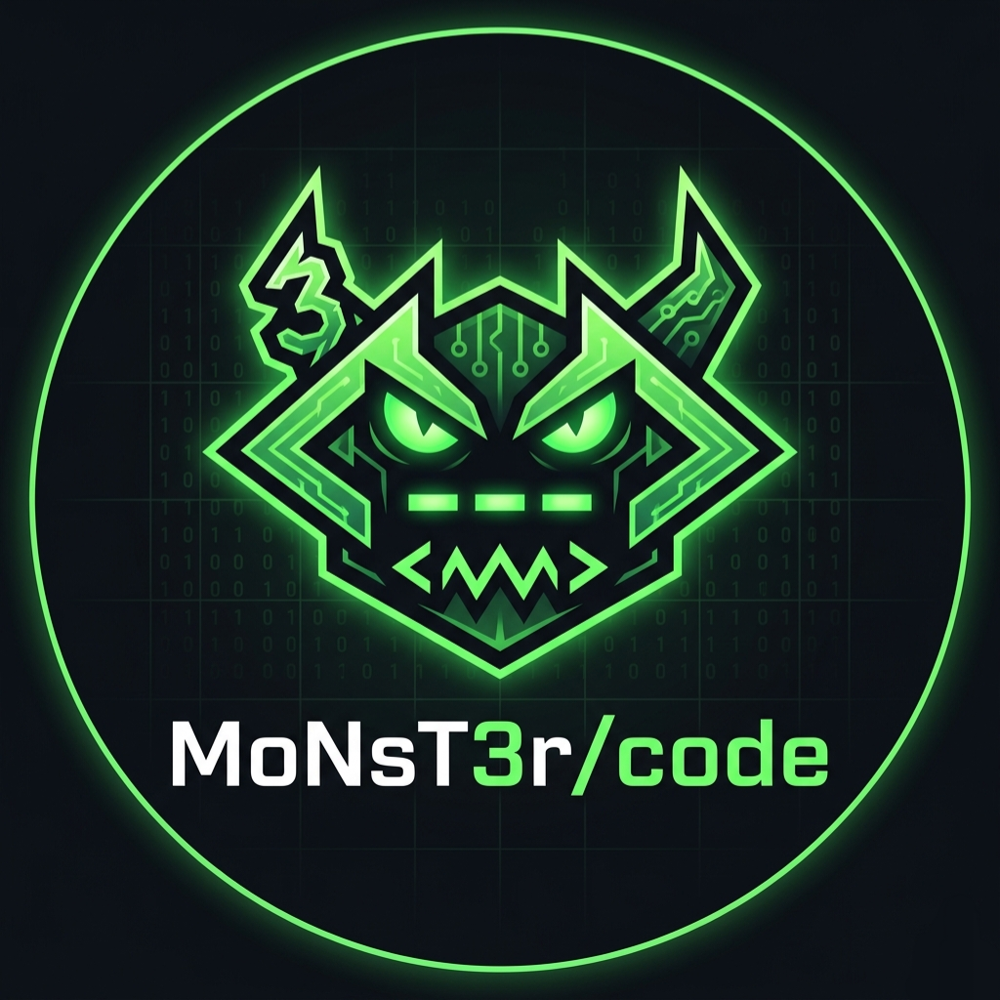

<div align="center">

<div style="display: flex; align-items: center; justify-content: center; gap: 15px; margin: 20px 0 10px 0;">
  

</div>

<p style="margin-top: 0; margin-bottom: 25px; color: #8b949e; font-size: 1.1em; font-style: italic;">
  Securing the architecture, line by line.
</p>

---

<div style="margin: 25px 0;">
  <a href="https://git.io/typing-svg">
    
  </a>
</div>

  <h5 style="margin-bottom: 20px; color: #00FF80;">
    <code>MS-SQL server</code> &nbsp;&middot;&nbsp;
    <code>Kali Linux</code> &nbsp;&middot;&nbsp;
    <code>Microsoft tools-Azure</code> &nbsp;&middot;&nbsp;
    <code>Claude Code</code> &nbsp;&middot;&nbsp;
    <code>Canva</code> &nbsp;&middot;&nbsp;
    <code>Cisco packet tracer</code> &nbsp;&middot;&nbsp;
    <code>VS Code-Google Colab-Antigravity</code>
  </h5>

</div>


## 🧠 Who Am I

```python
class MusfiraSehar:
    def __init__(self):
        self.role       = "BS Computer Science @ University · Trainee IT Programmer Analyst I @ Multinational Company"
        self.mindset    = "Building AI systems that cite their sources, and securing the web apps around them."

        self.stack      = ["Python", "TypeScript", "JavaScript", "React", "SQL", "C", "Linux"]
        self.exploring  = ["LLM & Agent Security", "RAG Architectures", "Web Application Security", "Parallel Computing"]
        self.platforms  = ["Kali Linux", "Ubuntu", "Windows"]

        self.fun_fact   = "I build secure AI tools by day and organise university tech events in my spare time."
```

---

## <span style="color: #00FF80;">About Me</span>

<details open>
<summary><b style="color: #00FF80;">Current Work</b></summary>
<br>
Completed my internship as a Trainee IT Programmer Analyst I on the AI Team and R&amp;D at Stewart (July to October 2026). I worked on agentic RAG systems, Claude Code skills and AI security research.
</details>

<details>
<summary><b style="color: #00FF80;">Academic Path</b></summary>
<br>
BS Computer Science at Forman Christian College University (expected 2028). Coursework includes parallel computing & operating systems, compilers, networking, cybersecurity, AI and database systems.
</details>

<details>
<summary><b style="color: #00FF80;">What I Build</b></summary>
<br>
AI workflows with LangGraph, retrieval-augmented generation pipelines, full-stack web applications and interactive 3D browser games.
</details>

<details>
<summary><b style="color: #00FF80;">What I Break</b></summary>
<br>
Web and LLM applications. I've completed 50+ PortSwigger Web Security Academy labs and OWASP LLM Top 10 training, and I study prompt injection and tool poisoning.
</details>

<br>

> <b style="color: #00FF80;">Core Philosophy:</b> *“The best way to understand a complex system is to build it yourself, test its limits, and leave no edge case undocumented.”*

---

# Tech Stack:


---

<div align="center">

# Analytics Dashboard:

| Top Languages Used |
| :---: |
|  
</div>

---
